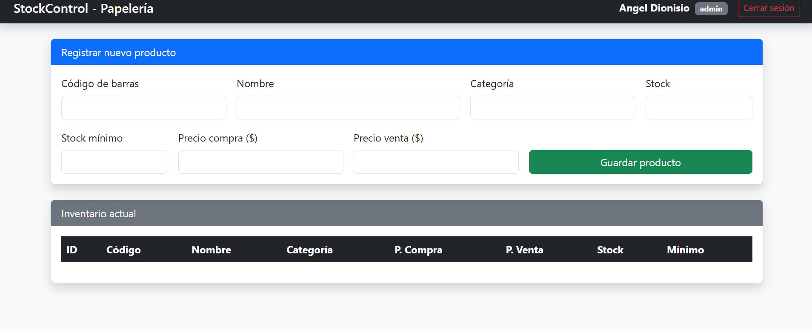

# StockControl — Sistema Web de Gestión de Inventario y Ventas para Papelería

**Programación Web — Proyecto Final**  
**Repositorio:** `https://github.com/ElNovaX/StockControl`

---

## 1. Datos Generales del Proyecto

| Rubro | Especificación |
| :--- | :--- |
| **Nombre del Sistema** | StockControl |
| **URL de Acceso Local** | `http://localhost:8080/StockControl` |
| **Línea Temática** | Gestión de Inventario y Ventas (orientado a comercio local: papelería y miscelánea) |
| **Integrantes del Equipo** | Juárez Velazquez Diana Donaji, Angel Dionisio Colula, Dante Emir Salazar Jarillo, Jaime Emmanuel López Cortés |

---

## 2. Descripción del Problema y Justificación

En los pequeños comercios locales, como papelerías y misceláneas, el control tradicional del inventario mediante libretas físicas o registros manuales suele provocar mermas de mercancía, desabastecimiento de artículos de alta rotación y errores en el cálculo diario de ingresos.

**StockControl** surge como una solución web dinámica diseñada para digitalizar y automatizar el control de existencias, el registro de ventas y la gestión del catálogo de productos, brindando una herramienta intuitiva tanto para administradores como para empleados del establecimiento.

---

## 3. Objetivos del Proyecto

* **Objetivo General:** Desarrollar una aplicación web dinámica bajo el patrón de arquitectura en capas utilizando controladores, vistas web y persistencia en base de datos relacional.
* **Seguridad en Persistencia:** Implementar un acceso seguro a datos utilizando consultas preparadas para mitigar vulnerabilidades de inyección SQL.
* **Control de Acceso por Roles:** Gestionar la autenticación y los permisos operativos diferenciados (administradores y empleados) mediante el manejo de sesiones.
* **Funcionalidad Integral:** Proveer módulos completos de gestión (CRUD), punto de venta en tiempo real, validación de formularios y alertas visuales de stock bajo.

---

## 4. Arquitectura y Stack Tecnológico

El proyecto está estructurado bajo una separación limpia de responsabilidades (`conexion`, `model`, `dao` y `controller`) para mantener el código modular y escalable.

| Componente | Herramienta y Configuración Implementada |
| :--- | :--- |
| **Entorno de Desarrollo (IDE)** | IntelliJ IDEA (Proyecto Maven `StockControl`) / Sublime Text |
| **Lenguaje y Compilación** | Java 17 (`maven.compiler.source` y `target` en versión 17) / PHP |
| **Servidor de Aplicaciones** | Apache Tomcat 8.5.96 ejecutado vía Smart Tomcat en `/StockControl` (puerto `8080`) / XAMPP |
| **Motor de Base de Datos** | MySQL gestionado con XAMPP/phpMyAdmin (motor `InnoDB`, cotejamiento `utf8mb4_general_ci`) |
| **Frontend y Vistas** | JavaServer Pages (JSP), HTML5, Bootstrap y hojas de estilo CSS |

---

## 5. Modelo de Datos (Base de Datos `stockcontrol`)

La base de datos relacional está compuesta por **4 tablas principales** diseñadas bajo el motor **InnoDB** y cotejamiento `utf8mb4_general_ci` para garantizar la integridad referencial:

| Tabla | Motor | Cotejamiento | Descripción y Función en el Sistema |
| :--- | :--- | :--- | :--- |
| **`usuarios`** | InnoDB | `utf8mb4_general_ci` | Almacena las credenciales y perfiles de acceso al sistema (como el perfil `admin`) para la autenticación y control de roles mediante sesiones. |
| **`productos`** | InnoDB | `utf8mb4_general_ci` | Registro maestro del inventario que incluye código de barras, nombre, categoría asociada, precios de compra y venta, stock actual y stock mínimo. |
| **`ventas`** | InnoDB | `utf8mb4_general_ci` | Encabezado de las transacciones comerciales realizadas (fecha, usuario que registró la venta y monto total). |
| **`detalle_ventas`** | InnoDB | `utf8mb4_general_ci` | Tabla intermedia que desglosa los productos vendidos, cantidades y subtotales asociados a cada folio de venta. |

---

## 6. Módulos y Funcionalidades Desarrolladas

| Módulo | Descripción Funcional |
| :--- | :--- |
| **Autenticación y Sesiones** | Validación de credenciales de acceso y gestión de sesión activa, mostrando el nombre del usuario autenticado, su rol (`admin`) y opción de cierre de sesión en la barra superior. |
| **Gestión Integral de Productos (CRUD)** | Formulario para el alta de artículos de papelería con código de barras, nombre, categoría, stock inicial, stock mínimo, precio de compra y precio de venta, acompañado de validaciones obligatorias en el cliente antes del envío. |
| **Visualización de Inventario Actual y Alertas** | Tabla dinámica que despliega los productos registrados junto con sus precios y niveles de existencia mediante indicadores visuales de estado respecto al umbral mínimo configurado. |
| **Punto de Venta (POS)** | Registro de salidas de mercancía con cálculo de totales y actualización en tiempo real de las existencias en base de datos. |

---

## 7. Evidencia de Implementación y Pruebas Funcionales

### Interfaz general del sistema e inventario

### Formulario de alta de productos

### Validación de campos obligatorios

### Registro de prueba persistido en inventario

| ID | Código | Nombre | Categoría | P. Compra | P. Venta | Stock | Mínimo |
| :---: | :---: | :--- | :--- | :---: | :---: | :---: | :---: |
| 1 | `12345654` | Folder | Oficio | $5.00 | $7.00 | 500 | 100 |

---

## 8. Control de Versiones y Colaboración (GitHub)

El código fuente del proyecto se gestiona de forma colaborativa en el repositorio oficial de GitHub (`ElNovaX/StockControl`). Los cuatro integrantes participan de manera rotativa en el desarrollo del backend, el modelado de la base de datos y las vistas, integrando cambios mediante commits, ramas y documentación técnica en `README.md`.
