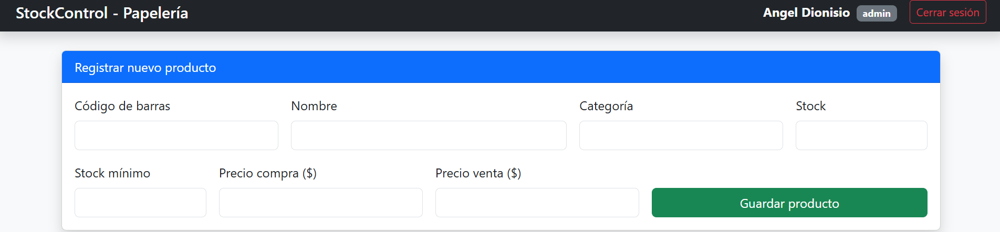
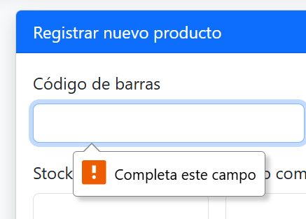

# StockControl - Sistema de Control de Inventario y Papelería

Aplicación web para la gestión de inventario y control de acceso por roles en una papelería, conectada a una base de datos relacional en MySQL.

## Características principales
- **Autenticación y sesiones:** Inicio y cierre de sesión mediante `$_SESSION` (`login.php` y `logout.php`).
- **Control por roles:** Diferenciación entre usuarios `admin` y `empleado` (restringiendo la visualización del precio de compra según el rol).
- **Gestión de productos:** Registro de nuevos artículos e inventario con alertas visuales cuando el stock es menor o igual al stock mínimo (`productos.php`).
- **Consultas seguras:** Uso de `MySQLi` con consultas preparadas (`prepare` y `bind_param`).

## Tecnologías utilizadas
- **Backend / Lógica:** PHP con MySQLi
- **Frontend:** HTML5, CSS3 y Bootstrap 5
- **Base de datos:** MySQL (`stockcontrol_db` con tablas `usuarios`, `productos`, `ventas` y `detalle_ventas`)
- **Servidor local y editor:** XAMPP (Apache y MySQL) y Sublime Text
- **Control de versiones:** Git y GitHub

## Instalación y ejecución local
1. Clonar o copiar la carpeta `StockControl` dentro de `C:\xampp\htdocs\StockControl`.
2. Iniciar **Apache** y **MySQL** desde el panel de control de **XAMPP**.
3. Verificar que exista la base de datos `stockcontrol_db` con sus tablas (`usuarios`, `productos`, `ventas`, `detalle_ventas`) en phpMyAdmin.
4. Abrir en el navegador: `http://localhost/StockControl/login.php`.

Control de acceso por roles y registro de operaciones para papelerías y misceláneas locales[cite: 14, 20]. Permite digitalizar el control de existencias para evitar mermas, desabastecimiento de artículos de alta rotación y errores en registros manuales[cite: 14].

## Lo que se realizó en el proyecto
- **Base de datos relacional (`stockcontrol_db` / `stockcontrol`):** Modelado con motor `InnoDB` y cotejamiento `utf8mb4_general_ci` mediante las tablas `usuarios`, `productos`, `ventas` y `detalle_ventas`[cite: 7, 15].
- **Conexión segura (`conexion.php`):** Enlace a MySQL en XAMPP utilizando `MySQLi`, manejo de errores de conexión y codificación `utf8mb4`.
- **Autenticación y control de sesiones (`login.php` y `logout.php`):** Validación de credenciales con consultas preparadas (`prepare` y `bind_param`), control de sesión activa con `$_SESSION` y cierre de sesión limpio[cite: 20].
- **Control de roles (`admin` vs. `empleado`):** Restricción y visualización diferenciada según el rol del usuario autenticado (como la vista del precio de compra en el inventario)[cite: 20].
- **Gestión de inventario (`productos.php`):** Alta de productos (código de barras, nombre, categoría, stock inicial, stock mínimo, precio de compra y precio de venta), validación de campos obligatorios, tabla de inventario actual e indicadores visuales cuando el stock es menor o igual al stock mínimo[cite: 16, 17, 20].
- **Arquitectura académica y despliegue:** Documentación técnica de la estructura modular (`conexion`, `controller`, `dao`, `model`), configuración en entorno local y control de versiones con Git y GitHub en el repositorio `ElNovaX/StockControl`[cite: 10, 15, 18].

## Evidencias e imágenes del sistema

### Interfaz general de inventario

### Celdas de creación de productos

### Validación de campos obligatorios

